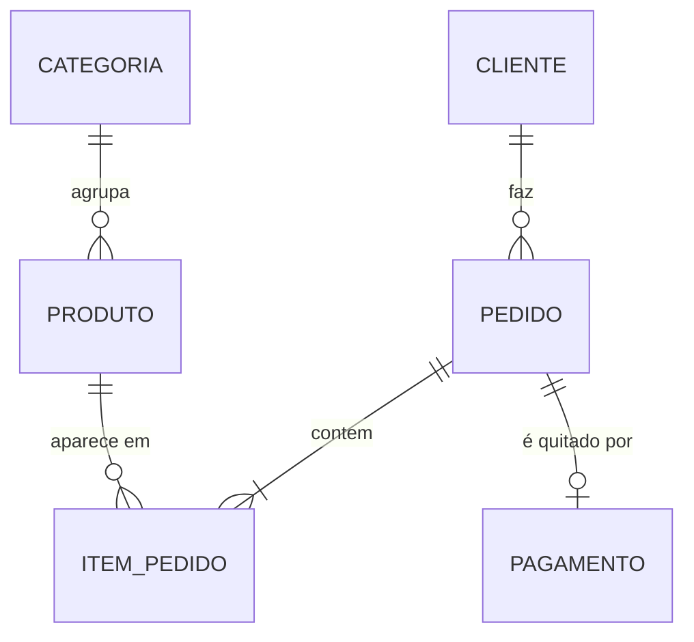

# Banco de Dados com MySQL — Loja Virtual

Material didático de **Banco de Dados** que percorre, em um único estudo de caso, o caminho completo do modelo conceitual até objetos programáveis no **MySQL 8**.

> Usado nas disciplinas de Banco de Dados dos cursos de Análise e Desenvolvimento de Sistemas e Engenharia — Prof. Eduardo Furlanetti.

## Estudo de caso

Uma loja virtual registra **clientes**, **produtos** organizados em **categorias**, **pedidos** com seus **itens** e o **pagamento** de cada pedido.



## O que você vai praticar

| Tema | Onde |
|---|---|
| DDL: tabelas, chaves primárias e estrangeiras, `UNIQUE`, `CHECK`, `ENUM`, índices | `scripts/01_schema.sql` |
| DML: carga de dados | `scripts/02_dados.sql` |
| `JOIN`, `GROUP BY`/`HAVING`, subconsultas, CTE e funções de janela | `scripts/03_consultas.sql` |
| *View*, *trigger*, *stored procedure* e transações | `scripts/03_consultas.sql` |
| Lista de exercícios com soluções | `exercicios/` |

## Como executar

### Opção 1 — Docker (recomendado)

```bash
docker compose up -d
docker exec -it loja-mysql mysql -uroot -proot loja_virtual
```

O esquema e os dados são carregados automaticamente na primeira inicialização. Depois, rode as consultas:

```bash
docker exec -i loja-mysql mysql -uroot -proot < scripts/03_consultas.sql
```

### Opção 2 — MySQL instalado localmente / MySQL Workbench

Execute os scripts na ordem: `01_schema.sql` → `02_dados.sql` → `03_consultas.sql`.

## Estrutura

```
.
├── docker-compose.yml
├── scripts/
│   ├── 01_schema.sql      # criação do banco
│   ├── 02_dados.sql       # dados de exemplo
│   └── 03_consultas.sql   # consultas e objetos programáveis
└── exercicios/
    ├── lista.md
    └── solucoes.sql
```

## Licença

[MIT](LICENSE) — sinta-se à vontade para usar em suas aulas, citando a fonte.
